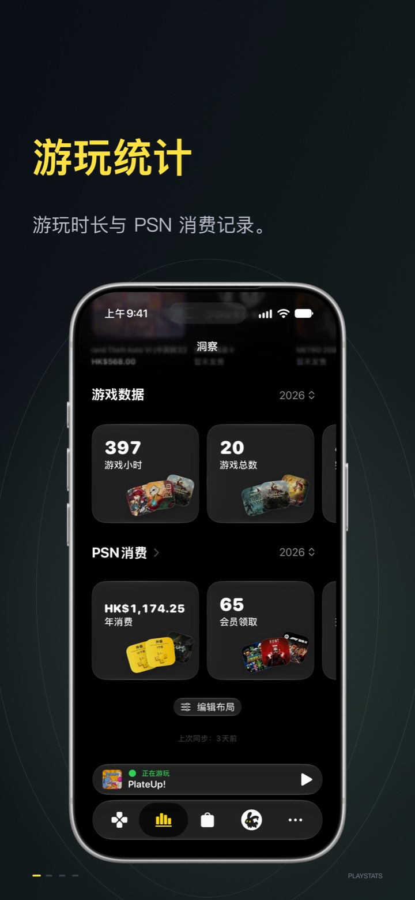
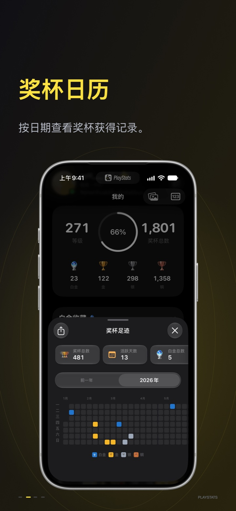
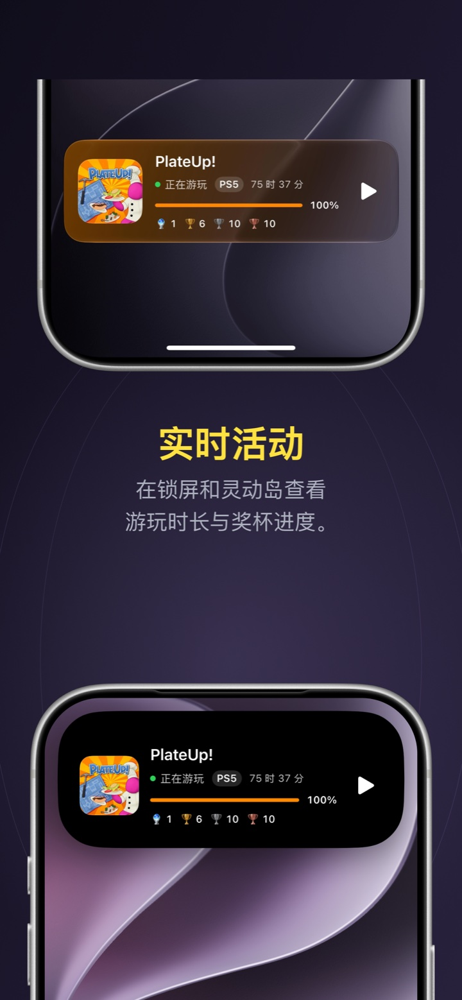
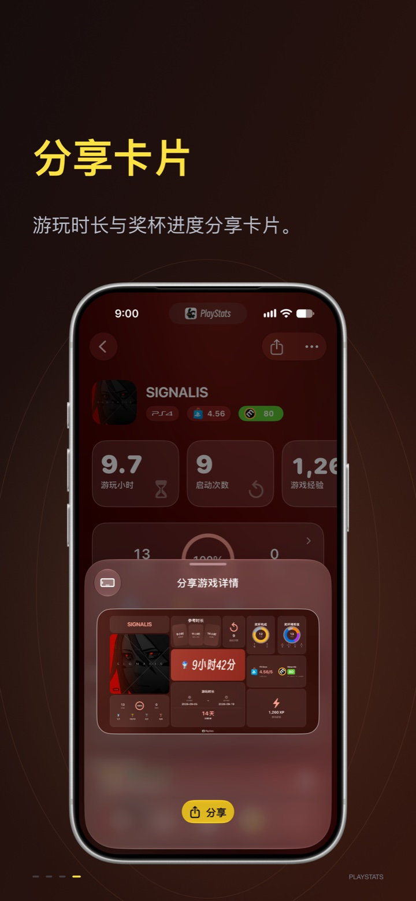

  
  <h1>PlayStats</h1>
  
<strong>每一场游戏，都有你的记录。</strong>

  
为 PlayStation 玩家打造的数据伴侣，回顾、整理和分享你的游戏历程。

  

    <a href="https://apps.apple.com/us/app/playstats/id6799940098">App Store 下载</a> ·
    <a href="https://testflight.apple.com/join/JAkUz1B6">加入 TestFlight</a>
  

  
iPhone · iPad · 中文 / English

## 让你的游戏历程清晰可见

- **游玩统计**：浏览游戏库、最近游玩与累计时长，了解自己的游戏足迹。
- **PSN 消费**：查看消费记录与年度趋势，回顾每一份游戏投入。
- **奖杯日历**：按日期查看奖杯记录，整理白金收藏与解锁进度。
- **实时活动与小组件**：在锁定屏幕、灵动岛和主屏幕查看游戏信息。
- **分享卡片**：将游玩时长和奖杯进度生成图片，分享值得纪念的时刻。

## App 预览

  
  
  
  

## Your gaming story, in stats

PlayStats is an independent companion app for PlayStation players. Bring your library, playtime, trophies and PSN spending together to explore and share your gaming journey.

- **Playtime stats** — Explore your library, recently played games and total hours.
- **PSN spending** — Review your transactions and annual spending trends.
- **Trophy calendar** — Look back at unlocks by date and explore your platinum collection.
- **Live Activities & widgets** — Keep your gaming information on the Lock Screen, Dynamic Island and Home Screen.
- **Share cards** — Turn playtime and trophy progress into images to save and share.

[Download on the App Store](https://apps.apple.com/us/app/playstats/id6799940098) · [Join TestFlight](https://testflight.apple.com/join/JAkUz1B6)

---

PlayStats 是独立的第三方应用，与 Sony Interactive Entertainment Inc. 无官方关联。

PlayStats is an independent third-party app and is not affiliated with Sony Interactive Entertainment Inc.
